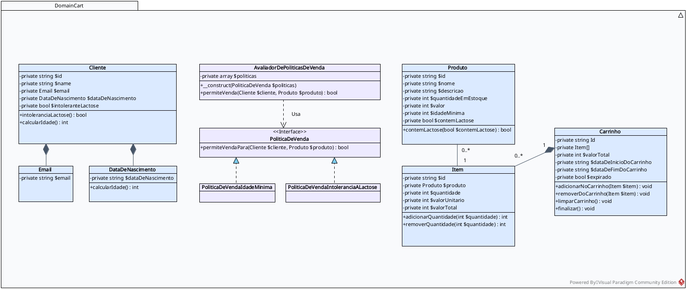
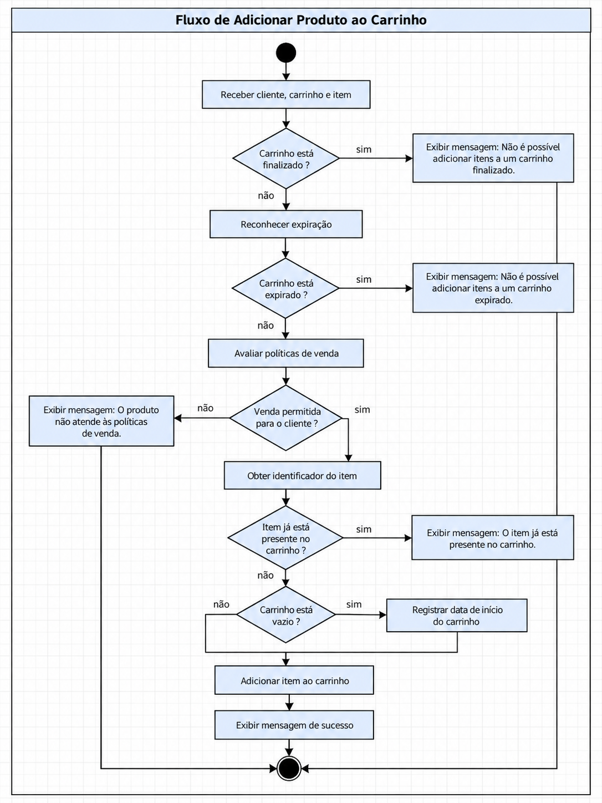
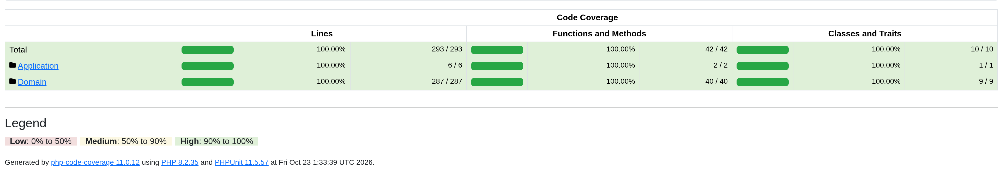

# DomainCart

[](https://github.com/GuilhermeAlamino/DomainCart/actions/workflows/quality.yml)


**Um carrinho de compras construído a partir de requisitos, regras de negócio e decisões explícitas de modelagem.**

O DomainCart é um projeto em **PHP 8.2** que explora o domínio de um carrinho de compras. O foco não é construir um e-commerce completo, mas demonstrar como uma solicitação de negócio pode ser investigada, documentada, modelada e traduzida em comportamentos verificáveis.

> Uma solicitação como “preciso de uma loja com carrinho de compras” é o começo da conversa, não uma especificação pronta para implementar.

[**Entenda o problema e os requisitos →**](docs/requisitos.md)

## Do requisito ao código

O desenvolvimento parte de perguntas sobre o negócio: quem compra, quais restrições se aplicam aos produtos, como os itens são representados e quando um carrinho pode ser alterado ou finalizado.

A documentação registra as decisões e seus limites. A implementação busca refletir essas regras; os testes verificam os comportamentos esperados.



*Diagrama do domínio — adicionar a imagem final em `docs/assets/diagrama-dominio.png`.*

[**Como o domínio foi modelado →**](docs/modelagem-do-dominio.md)

## O que foi modelado

| Conceito | Responsabilidade |
| --- | --- |
| **Cliente** | Informações necessárias à aplicação das regras comerciais. |
| **Produto** | Dados do produto, preço de venda, estoque e características relevantes para a venda. |
| **Item** | Produto selecionado, quantidade e valor unitário considerado no carrinho. |
| **Carrinho** | Seleção de itens, valor total e ciclo de vida da compra. |
| **Políticas de venda** | Restrições comerciais independentes, avaliadas por um contrato comum. |

## Caso de uso: adicionar produto ao carrinho

O fluxo abaixo apresenta as etapas e validações para adicionar
um produto ao carrinho.



## Decisões que merecem destaque

**Preço no item.** O item registra o valor unitário considerado na seleção, separando-o do preço atual do produto. A política de atualização ou validade desse valor depende dos requisitos de negócio.

**Políticas independentes.** Restrições de idade e lactose são representadas por implementações de uma interface comum. O padrão **Strategy** surgiu da necessidade de variar regras comerciais sem concentrá-las em uma única classe.

**Escopo consciente.** Cadastro administrativo, autenticação e acompanhamento completo de abandono de carrinhos não são pressupostos apenas porque conceitos relacionados apareceram na análise.

[**Leia as decisões técnicas e suas justificativas →**](docs/decisoes-tecnicas.md)

### Testes e qualidade

O DomainCart utiliza PHPUnit 11 para verificar os
comportamentos e as regras de negócio do domínio.

Os testes automatizados exercitam as responsabilidades
das entidades e as restrições comerciais implementadas.



*Relatório de cobertura — substituir pela captura real e identificar a métrica (por exemplo, cobertura de linhas). Cobertura não significa ausência de defeitos.*

Execute os testes:

```bash
composer install
./vendor/bin/phpunit tests/
```

Para gerar um relatório HTML de cobertura com Xdebug configurado:

```bash
XDEBUG_MODE=coverage ./vendor/bin/phpunit tests/ --coverage-html coverage/ --coverage-filter src/
```

## Explore a documentação

- [**Requisitos e critérios de aceitação**](docs/requisitos.md) — o que foi solicitado, refinado e especificado.
- [**Modelagem do domínio**](docs/modelagem-do-dominio.md) — como as entidades e responsabilidades foram identificadas.
- [**Decisões técnicas**](docs/decisoes-tecnicas.md) — alternativas, justificativas, consequências e limites.

---

*O objetivo é manter uma correspondência compreensível entre o problema investigado, os requisitos documentados, a modelagem, o código e os testes.*